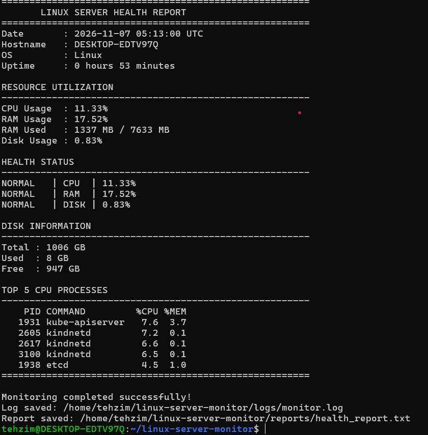
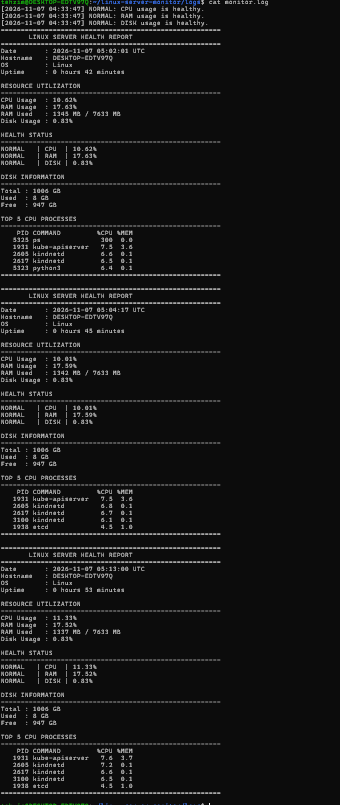
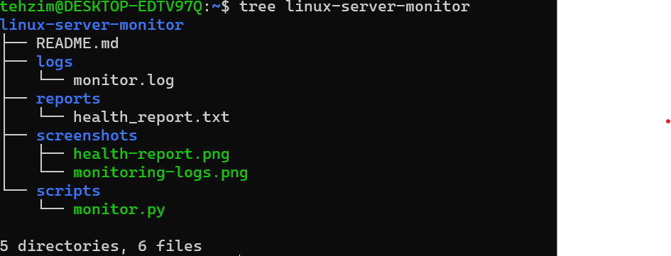

Linux Server Health Monitoring & Automation

Project Overview

A Linux server monitoring tool built using Python and Bash to monitor system health and identify resource utilization issues.

Features

- CPU utilization monitoring
- RAM utilization monitoring
- Disk usage monitoring
- System uptime monitoring
- Top 5 CPU-consuming processes
- Threshold-based health status
- Normal, Warning and Critical alerts
- Automatic log generation
- Health report generation

Technologies Used

- Linux (Ubuntu / WSL2)
- Python 3
- Bash
- Git & GitHub

Project Structure

linux-server-monitor/
│
├── scripts/
│   └── monitor.py
│
├── logs/
├── reports/
├── screenshots/
│   ├── health-report.png
│   ├── monitoring-logs.png
│   └── project-structure.png
│
├── README.md
└── .gitignore

How to Run

python3 scripts/monitor.py

Alert Thresholds

Resource| Warning| Critical
CPU| 70%| 90%
RAM| 70%| 90%
Disk| 80%| 90%

Output

The script generates a server health report and stores monitoring history in log files.

## Project Screenshots

### Server Health Report

### Monitoring Logs

### Project Structure

Learning Outcomes

- Linux system administration
- Python automation
- Bash scripting
- Resource monitoring
- Process management
- Log management
- Troubleshooting

Author

Tehzim Khan / Linux Administration Portfolio Project
